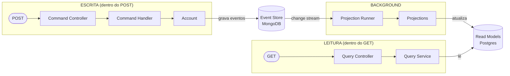
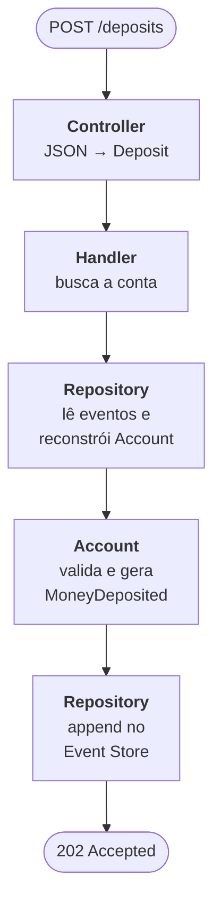
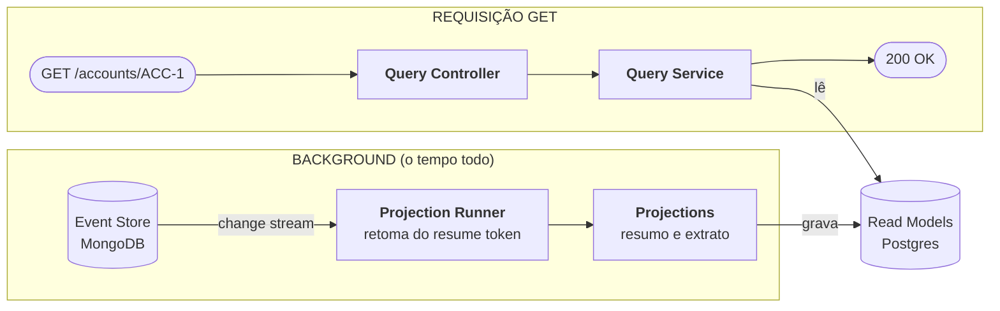
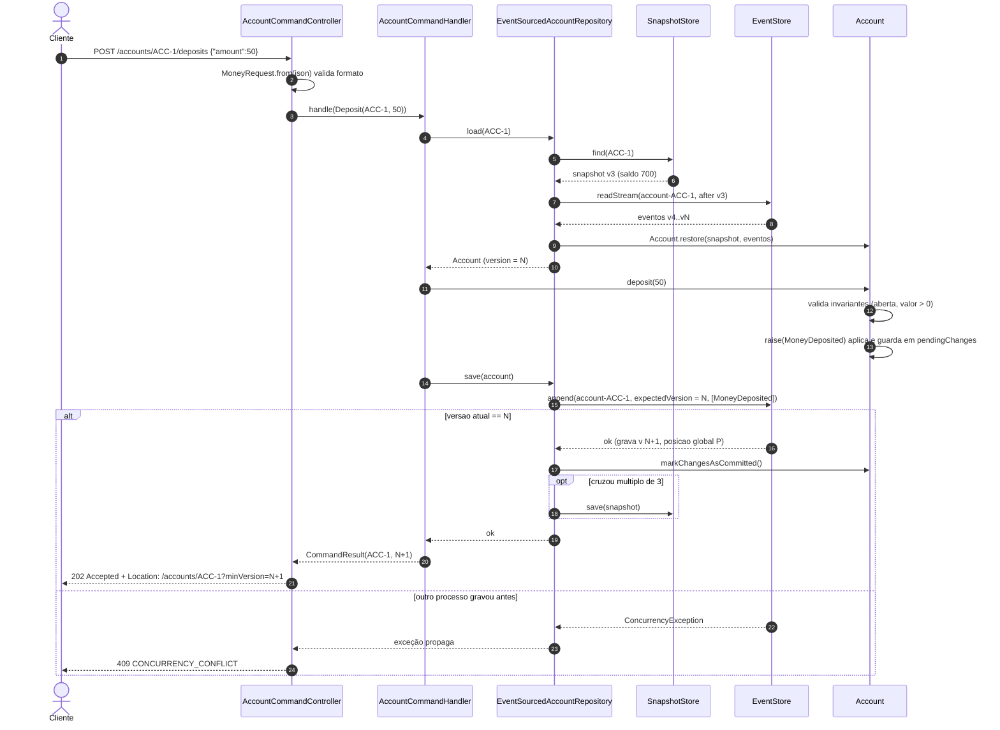
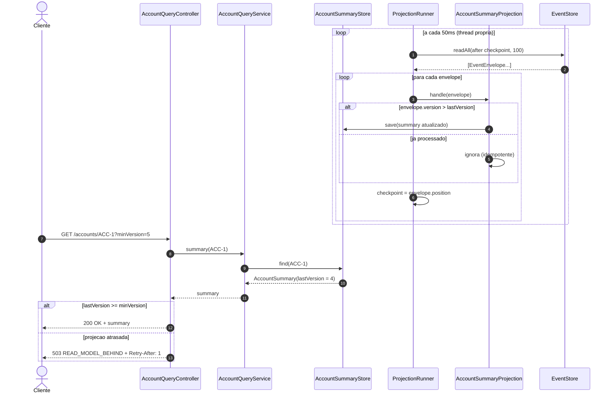
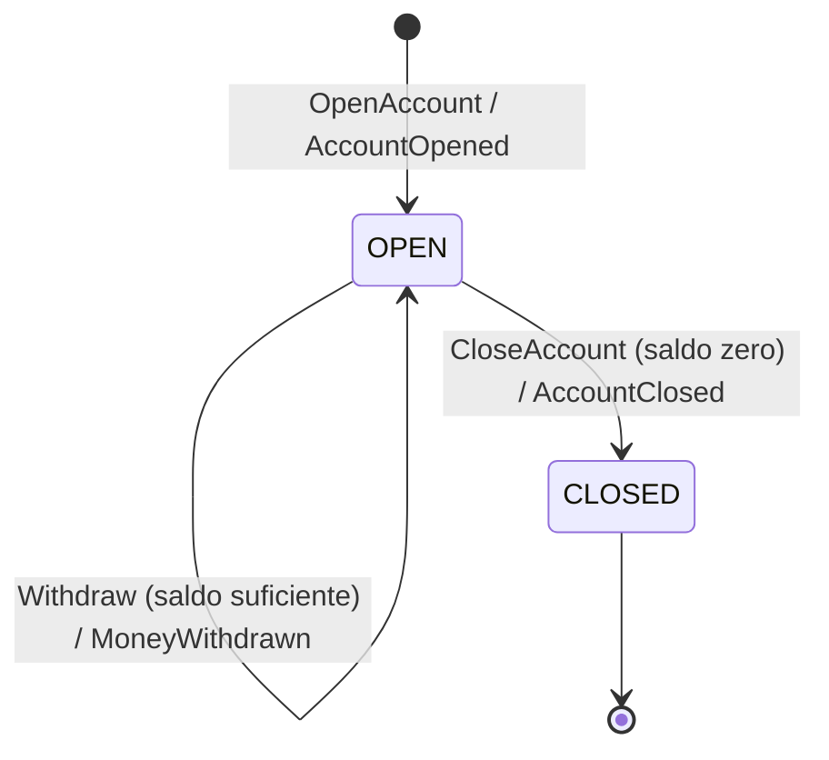
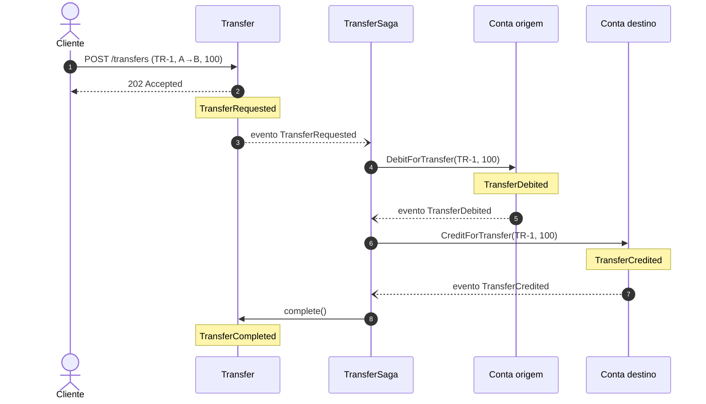
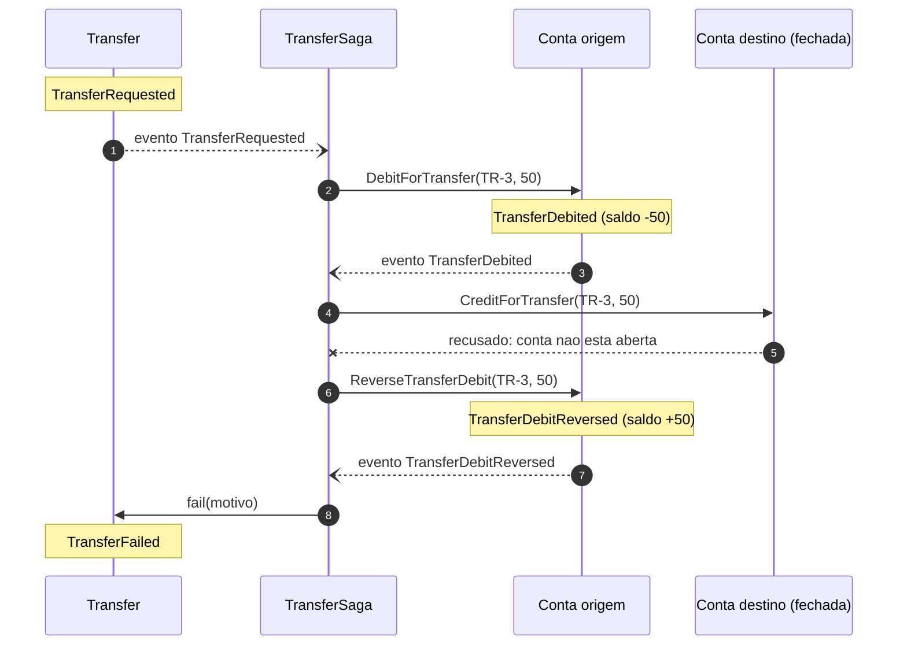
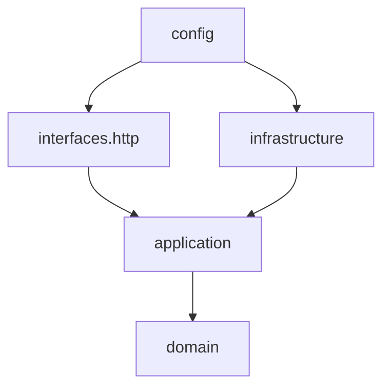
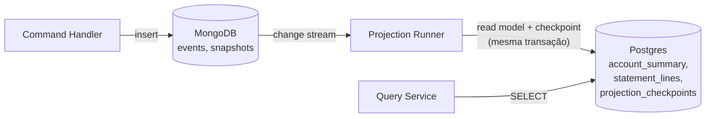

# CQRS + Event Sourcing — exemplo didático

Conta bancária com Spring Boot 4.1 + Java 25 e **dois bancos**: MongoDB para escrita (event store) e Postgres para leitura (read models). O Mongo alimenta o Postgres via **change streams** (CDC).

```bash
mvn spring-boot:run              # sobe Mongo (27019) + Postgres (5433) via docker-compose e a API em :8080
mvn test                         # testes com Mongo e Postgres reais via Testcontainers (precisa de Docker)
./scripts/api-demo.sh            # com a API rodando, exercita todos os endpoints via curl
```

`requests.http` tem as mesmas chamadas para rodar direto no IntelliJ / VS Code REST Client.

Os bancos persistem entre execuções (containers ficam de pé). Para zerar: `docker compose down -v`.

Para ver os dados:

```bash
# ESCRITA (Mongo): só fatos
docker exec -it cqrs-bank-mongo mongosh --port 27019 bank
db.events.find().sort({position: 1})
db.snapshots.find()

# LEITURA (Postgres): visões prontas para consulta
docker exec -it cqrs-bank-postgres psql -U bank -d bank
SELECT * FROM account_summary;
SELECT * FROM statement_lines ORDER BY account_id, version;
SELECT * FROM projection_checkpoints;
```

## Os dois conceitos

**CQRS (Command Query Responsibility Segregation)**: separa o modelo que *escreve* do modelo que *lê*.

- Write side recebe **comandos** (intenção: "quero sacar 300"), valida regras de negócio e decide.
- Read side responde **consultas** com modelos otimizados para leitura (extrato, ranking, resumo). Sem regra de negócio.

**Event Sourcing**: em vez de guardar o estado atual (`saldo = 750`), guarda a sequência de **fatos** (`Aberta`, `Depositou 1000`, `Sacou 300`, `Depositou 50`). O estado é derivado reproduzindo os eventos.

São independentes (dá para ter CQRS sem Event Sourcing), mas combinam bem: os eventos são a ponte entre o lado de escrita e o de leitura.

## Visão geral da arquitetura

### 1. Visão macro (comece por aqui)



Leia da esquerda para a direita. Escrita e leitura **nunca se falam diretamente**: a escrita só grava no Event Store; a leitura só lê dos Read Models; quem liga os dois é o bloco de background.

- **Escrita** acontece dentro da requisição POST.
- **Background** roda a qualquer momento depois, sozinho.
- **Leitura** acontece dentro da requisição GET e só enxerga o que o background já processou. Essa é a **consistência eventual**.

### 2. Zoom na escrita



Não existe tabela `accounts` com saldo. Para depositar, o sistema **reconstrói a conta a partir dos eventos**, decide e grava **só o evento novo**.

### 3. Zoom na leitura



A consulta é burra de propósito: o read model já está pronto (saldo calculado, extrato montado). Ela só busca e devolve. O trabalho foi feito antes, pela projeção.

Os diagramas de sequência abaixo mostram os mesmos caminhos com todos os detalhes (snapshot, conflito de versão, idempotência, `minVersion`).

## Fluxo de um comando: `POST /accounts/{id}/deposits`



Por que **202 Accepted** e não 200 com a conta? Porque o comando foi aceito e gravado, mas o read model ainda pode não refletir. A resposta devolve só `{accountId, version}` e o header `Location` aponta para a consulta com `minVersion`.

Três camadas de validação, cada uma com seu erro:

| Onde | O que valida | HTTP |
|---|---|---|
| Controller (`@Valid` em `MoneyRequest`, `OpenAccountRequest`) | Formato: campo presente, tipo certo | 400 `BAD_REQUEST` |
| Handler | Existência: conta existe / já existe | 404 `ACCOUNT_NOT_FOUND` / 409 `ACCOUNT_ALREADY_EXISTS` |
| Aggregate (`Account`) | Regra de negócio: saldo, status, valor positivo | 422 `BUSINESS_RULE_VIOLATION` |
| Event store | Concorrência: versão esperada | 409 `CONCURRENCY_CONFLICT` |

O mapeamento exceção → HTTP fica centralizado em `ApiExceptionHandler` (`@RestControllerAdvice`), respondendo `ProblemDetail` (RFC 9457) com um campo `code`. Domínio e aplicação não sabem que HTTP existe.

## Fluxo de leitura: projeção assíncrona + consulta



Os dois loops são **independentes**: o runner roda em background no seu ritmo; a consulta só lê o que já estiver projetado. `minVersion` é o mecanismo de **read-your-writes**: o cliente que acabou de gravar a versão 5 pede "só me responda se já tiver pelo menos a versão 5". Sem `minVersion`, recebe o que houver (possivelmente defasado).

Rodando `scripts/api-demo.sh` dá para ver isso acontecer: logo após o depósito que gera a versão 4, o read model ainda está na 3.

## Ciclo de vida do aggregate



Notação `Comando / Evento gerado`. Qualquer comando fora dessas transições é rejeitado e não gera evento.

## Transferência entre contas (saga)

### O problema

Cada conta é um aggregate: uma fronteira de consistência com seu próprio stream e sua própria versão. Uma transferência mexe em **duas** contas. Não existe uma transação que debite A e credite B ao mesmo tempo (seriam dois streams, e num sistema real talvez até dois serviços).

A saída é a **saga**: quebrar a operação em passos locais, cada um numa conta só, encadeados por eventos. Se um passo falhar depois que outro já aconteceu, a saga **compensa** (desfaz o que foi feito com um novo evento, nunca apagando).

### As peças

| Peça | Papel |
|---|---|
| `Transfer` (aggregate) | Guarda o pedido e o resultado: `TransferRequested` → `TransferCompleted` ou `TransferFailed` |
| `Account` | Ganhou 3 operações: `debitForTransfer`, `creditForTransfer`, `reverseTransferDebit` |
| `TransferSaga` | Escuta eventos e manda o próximo comando. Não guarda estado próprio: consulta o `Transfer` |
| `TransferProjection` | Read model `transfer_view` no Postgres com o status visível (`REQUESTED`, `DEBITED`, `CREDITED`, `REVERSED`, `COMPLETED`, `FAILED`) |

A saga roda no mesmo `ProjectionRunner` das projeções: ela é só mais um assinante do change stream, com seu próprio checkpoint (`transfer-saga`).

### Caminho feliz



A requisição HTTP termina no passo 2. Tudo depois acontece em background, evento a evento. O cliente acompanha por `GET /transfers/TR-1`.

### Falha com compensação

Se o débito falhar (saldo insuficiente), nada se moveu: a saga só marca `TransferFailed`.

Se o **crédito** falhar (destino encerrado), o dinheiro já saiu da origem. A saga estorna:



O histórico da conta de origem fica com as duas linhas, débito e estorno. Nada é apagado: o extrato mostra exatamente o que aconteceu.

### As três regras que fazem a saga funcionar

1. **Cada passo é idempotente.** O runner entrega eventos *pelo menos uma vez*: se cair depois de debitar e antes de salvar o checkpoint, o `TransferRequested` volta. Por isso `Account` guarda quais operações de transferência já aplicou (`debit:TR-1`, `credit:TR-1`, `reversal:TR-1`) e ignora repetição. Esse conjunto entra no snapshot.
2. **A saga confere o estado antes de agir.** Só debita/credita se o `Transfer` ainda está `REQUESTED`. Sem isso, um replay de um `TransferRequested` antigo que falhou por saldo poderia debitar hoje, quando a conta já tem saldo.
3. **Compensação não pode falhar.** `reverseTransferDebit` não exige conta aberta nem saldo: é a correção de algo que já aconteceu.

Erros técnicos (ex.: `ConcurrencyException` porque o cliente depositou na mesma conta no mesmo instante) fazem o runner **tentar o mesmo evento de novo** depois de um intervalo. Erros de negócio (`DomainException`) não são retentados: a saga os transforma em falha/compensação.

## Endpoints

| Método | Rota | Lado | Lê de |
|---|---|---|---|
| POST | `/accounts` `{"accountId","owner"}` | Comando | event store (via repositório) |
| POST | `/accounts/{id}/deposits` `{"amount"}` | Comando | event store |
| POST | `/accounts/{id}/withdrawals` `{"amount"}` | Comando | event store |
| POST | `/accounts/{id}/close` | Comando | event store |
| GET | `/accounts/{id}?minVersion=n` | Consulta | `AccountSummaryStore` |
| GET | `/accounts/{id}/statement` | Consulta | `StatementStore` |
| GET | `/rankings/balance?limit=n` | Consulta | `AccountSummaryStore` |
| GET | `/accounts/{id}/events` | Consulta (auditoria) | event store direto |
| POST | `/transfers` `{"transferId","sourceAccountId","targetAccountId","amount"}` | Comando (inicia saga) | event store |
| GET | `/transfers/{id}` | Consulta | `transfer_view` |
| GET | `/admin/projections` | Operação | checkpoint e lag de cada projeção |
| POST | `/admin/projections/{name}/rebuild` | Operação | apaga read model e reprocessa histórico |

`/events` é o único GET que lê do event store: serve para auditoria e para enxergar os fatos brutos. Consultas de produto devem ir para read models.

## Estrutura de pacotes

```
src/main/java/bank
├── BankApplication                         @SpringBootApplication
├── config
│   ├── ApplicationConfig                   @Configuration: cria os beans de application (sem anotação neles)
│   └── BankProperties                      @ConfigurationProperties (snapshot-every, projection-poll-interval)
├── interfaces/http                         ADAPTADOR DE ENTRADA
│   ├── ApiExceptionHandler                 @RestControllerAdvice: exceção → ProblemDetail
│   ├── command
│   │   ├── AccountCommandController        @RestController: POST → Command → handler → 202
│   │   └── OpenAccountRequest, MoneyRequest   DTOs de entrada com Bean Validation
│   ├── query
│   │   └── AccountQueryController          @RestController: GET → query service → 200
│   ├── transfer
│   │   ├── TransferCommandController       POST /transfers → 202
│   │   ├── TransferQueryController         GET /transfers/{id}
│   │   └── TransferRequest
│   └── admin
│       └── ProjectionAdminController       status e rebuild das projeções
├── domain                                  regra de negócio pura, ZERO Spring
│   ├── shared/AggregateRoot, DomainEvent, DomainException
│   ├── account
│   │   ├── Account                         aggregate root (+ operações de transferência idempotentes)
│   │   ├── AccountEvent (sealed)           AccountOpened, MoneyDeposited, MoneyWithdrawn, AccountClosed,
│   │   │                                   TransferDebited, TransferCredited, TransferDebitReversed
│   │   └── AccountStatus, AccountSnapshot
│   └── transfer
│       ├── Transfer                        aggregate root da transferência
│       ├── TransferEvent (sealed)          TransferRequested, TransferCompleted, TransferFailed
│       └── TransferStatus
├── application                             casos de uso + portas, ZERO Spring
│   ├── eventstore
│   │   ├── EventStore                      porta do event store
│   │   ├── EventEnvelope                   evento + metadados (posição global, stream, versão)
│   │   ├── EventSubscriber                 quem reage a eventos: projeções e sagas
│   │   ├── AccountStream, TransferStream   convenção de nome dos streams
│   │   └── ConcurrencyException
│   ├── command                             WRITE SIDE (conta)
│   │   ├── Command (sealed)                OpenAccount, Deposit, Withdraw, CloseAccount,
│   │   │                                   DebitForTransfer, CreditForTransfer, ReverseTransferDebit
│   │   ├── AccountCommandHandler           carrega aggregate, executa, salva, devolve CommandResult
│   │   ├── AccountRepository               porta de persistência do aggregate
│   │   └── CommandRejectedException        AccountNotFoundException, AccountAlreadyExistsException
│   ├── transfer                            WRITE SIDE (transferência)
│   │   ├── TransferCommandHandler          request, complete, fail
│   │   ├── TransferRepository              porta
│   │   └── TransferSaga                    EventSubscriber que orquestra débito → crédito → conclusão/estorno
│   └── query                               READ SIDE
│       ├── AccountQueryService             consultas nos read models (+ checagem de minVersion)
│       ├── AccountAuditService             histórico bruto do event store
│       ├── TransferQueryService            status da transferência
│       ├── AccountSummary, StatementLine, AuditEntry, TransferView   read models (DTOs planos)
│       ├── AccountSummaryStore, StatementStore, TransferViewStore    portas dos read stores
│       ├── ReadModelBehindException, AccountViewNotFoundException
│       └── projection
│           ├── Projection                  EventSubscriber + reset (só projeções podem ser reconstruídas)
│           ├── CheckpointStore, Checkpoint porta: até onde cada projeção leu (position + cursor opaco)
│           ├── ProjectionManager           porta de operação: status, rebuild
│           ├── AccountSummaryProjection
│           ├── StatementProjection
│           └── TransferProjection
└── infrastructure                          ADAPTADORES DE SAÍDA
    ├── eventstore/MongoEventStore                          @Repository (Mongo): append, readStream, readAll
    ├── eventstore/MongoEventMapper                         documento <-> evento, registro de tipos
    ├── persistence/SnapshotStore, MongoSnapshotStore       @Repository (Mongo)
    ├── persistence/EventSourcedAccountRepository           bean em ApplicationConfig (recebe snapshotEvery)
    ├── persistence/EventSourcedTransferRepository          bean em ApplicationConfig
    ├── projection/ProjectionRunner                         SmartLifecycle; uma thread + change stream por assinante, com retry
    ├── projection/JdbcCheckpointStore                      @Repository (Postgres): position + resume token
    └── readmodel/JdbcAccountSummaryStore, JdbcStatementStore, JdbcTransferViewStore   @Repository (Postgres)
```

Regra de dependência:



- `domain` não depende de ninguém.
- `application` depende só de `domain` e define portas (interfaces).
- `interfaces` (entrada) e `infrastructure` (saída) dependem de `application`, nunca um do outro.
- `config` é o único que conhece tudo, porque monta o grafo de objetos.

## Persistência: Mongo para escrita, Postgres para leitura



| Banco | Coleção / tabela | Conteúdo |
|---|---|---|
| Mongo | `events` | Fatos imutáveis. Índice único `(streamId, version)` = concorrência otimista. `position` vem de um contador e serve para replay e lag |
| Mongo | `snapshots` | Estado da conta a cada N eventos (cache; pode ser apagado) |
| Mongo | `counters` | Sequência global de `position` |
| Postgres | `account_summary`, `statement_lines` | Read models. Podem ser apagados e reconstruídos |
| Postgres | `transfer_view` | Read model do status das transferências |
| Postgres | `projection_checkpoints` | Por assinante (projeções e saga): maior `position` processada + **resume token** do change stream |

Schema do Postgres em `src/main/resources/db/migration` (Flyway). Índices do Mongo criados no startup por `MongoEventStore`.

### Como o evento chega do Mongo ao Postgres

1. Command grava um documento em `events` (Mongo). Fim da requisição.
2. Cada projeção tem uma thread com um **change stream** aberto na coleção `events`. O Mongo empurra cada insert, na ordem de commit (oplog). Não há polling de tabela.
3. Para cada evento, numa **transação do Postgres**: aplica a projeção e grava o checkpoint com o resume token do evento.
4. Se a aplicação cair, ao subir a projeção chama `resumeAfter(token)` e o Mongo reenvia tudo depois daquele ponto.
5. Sem checkpoint (primeira vez ou após rebuild): abre o change stream, faz **replay** do histórico lendo `events` por `position`, depois segue no stream. Eventos que chegarem durante o replay podem vir duas vezes; as projeções são idempotentes (ignoram versão já aplicada).

### O que muda com dois bancos

- **Não existe transação entre Mongo e Postgres.** A escrita commita no Mongo; a leitura commita no Postgres depois. O checkpoint fica no Postgres, junto com o read model, para que os dois avancem juntos.
- **Sem dual write.** O command não publica nada: só grava no Mongo. Quem leva o evento adiante é o change stream (CDC). Se o command gravasse no Mongo e depois publicasse no Kafka, uma queda entre os dois passos perderia o evento.
- **Ordem**: change stream entrega na ordem de commit, então o problema de "position commitada fora de ordem" do polling some.
- **Mongo precisa ser replica set** para ter change streams (oplog). O `docker-compose.yml` sobe um replica set de 1 nó; os testes usam `MongoDBContainer.withReplicaSet()`.
- **Atomicidade no Mongo é por documento.** Cada evento é um documento; nossos comandos geram um evento por vez. Se um comando gerasse vários, o correto seria gravá-los num único documento de "commit" ou usar transação do Mongo.

## Onde o Spring entra (e onde não entra)

| Camada | Spring? | Como |
|---|---|---|
| `domain` | Não | Java puro. Testável sem subir contexto |
| `application` | Não | Java puro. Beans criados em `ApplicationConfig` com `@Bean`, sem `@Service` nas classes |
| `interfaces.http` | Sim | `@RestController`, `@Valid`, `@RestControllerAdvice` |
| `infrastructure` | Sim | `@Repository` com `MongoTemplate` (escrita) e `JdbcClient` (leitura); `ProjectionRunner` é `SmartLifecycle` |
| `config` | Sim | `@Configuration`, `@ConfigurationProperties` |

Por que `@Bean` em vez de `@Service` na application? Para o núcleo (domain + application) não importar nada de framework. Trocar Spring por Quarkus/Micronaut mexeria só nas bordas.

Por que `SmartLifecycle` e não `@Scheduled`? O runner precisa de `start`/`stop` explícitos (rebuild, testes de consistência eventual). Com `SmartLifecycle` o Spring inicia o polling quando a app sobe e para no shutdown.

Configuração em `application.yml` (além do datasource):

```yaml
bank:
  snapshot-every: 3
  projection-poll-interval: 50ms
```

## Testes como roteiro

Cada conceito virou um teste em `src/test/java/bank`. Leia na ordem:

| Teste | Conceito |
|---|---|
| `EventSourcingConceptsTest.rejectedCommandDoesNotProduceEvent` | Comando inválido não deixa rastro no event store |
| `EventSourcingConceptsTest.closedAccountRejectsNewMovements` | Invariante de status no aggregate |
| `EventSourcingConceptsTest.readSideIsEventuallyConsistent` | Projeções paradas: write side vê 200, read side ainda vê 0. Depois convergem |
| `EventSourcingConceptsTest.snapshotAvoidsReplayingWholeHistory` | Snapshot na v3; load reaplica só 2 de 5 eventos |
| `EventSourcingConceptsTest.timeTravelRebuildsAnyPastVersion` | Estado da conta em qualquer versão passada |
| `EventSourcingConceptsTest.rebuildReplaysHistoryAndProducesSameReadModel` | Rebuild gera exatamente o mesmo read model |
| `EventSourcingConceptsTest.optimisticConcurrencyRejectsStaleWrite` | Dois processos na mesma versão: segundo é rejeitado |
| `AccountApiTest.commandsReturnAcceptedWithVersionAndQueryLocation` | Fluxo HTTP completo: 202 + `Location`, depois GETs |
| `AccountApiTest.errorsAreMappedToHttpStatus` | 400 / 404 / 409 / 422 |
| `AccountApiTest.queryAskingForFutureVersionReturnsServiceUnavailable` | `minVersion` → 503 + `Retry-After` |
| `TransferSagaTest.successfulTransferMovesMoneyBetweenAccounts` | Saga completa: débito, crédito, conclusão |
| `TransferSagaTest.insufficientFundsFailsWithoutMovingMoney` | Débito recusado: falha sem mover dinheiro |
| `TransferSagaTest.rejectedCreditIsCompensatedByReversingTheDebit` | Crédito recusado: estorno do débito (compensação) |
| `TransferSagaTest.redeliveredEventsAndRepeatedCommandsAreIdempotent` | Reentregar eventos e repetir comandos não move dinheiro de novo |
| `TransferSagaTest.transferToSameAccountIsRejectedUpFront` | Validação no aggregate `Transfer` |

## Pontos-chave no código

1. **`Account`: decidir vs aplicar.** Métodos públicos (`deposit`, `withdraw`, `close`) validam invariantes e chamam `raise`. `apply` só muda estado, sem validar, porque evento é fato consumado. Por isso `restore` nunca falha.
2. **Mudanças pendentes.** O aggregate acumula eventos em `pendingChanges`. O repositório grava com `expectedVersion = version()` e chama `markChangesAsCommitted`.
3. **Controller fino.** Converte HTTP ↔ comando/consulta e nada mais. `@Valid` cuida de formato; regra de negócio fica no aggregate.
4. **Controllers separados por lado.** `AccountCommandController` só conhece `AccountCommandHandler`; `AccountQueryController` só conhece os serviços de consulta. Dá para escalar/deployar os dois lados separadamente no futuro.
5. **Envelope vs evento.** Evento de domínio carrega só dado de negócio. Posição, versão e stream são metadados no `EventEnvelope`.
6. **Projeções idempotentes.** Ignoram evento com versão já processada. Reentrega (at-least-once) não duplica.
7. **Checkpoint.** `ProjectionRunner` guarda até onde cada projeção leu. Projeções avançam de forma independente.
8. **Read model plano.** `AccountSummary.status` é `String`, não `AccountStatus`. Read side não depende do domínio além dos eventos.

## O que muda no mundo real

- **Persistência**: alternativas ao Mongo para escrita: DynamoDB (gravação condicional + DynamoDB Streams), Postgres + Debezium, ou event store dedicado (EventStoreDB/Kurrent, Axon Server). Para leitura: Elasticsearch (busca), Redis (lookup por chave).
- **Distribuição de eventos**: aqui o change stream vai direto para as projeções. Com muitos consumidores (outros serviços), o padrão é change stream / Debezium → Kafka → consumidores. Checkpoint persistido junto com o read model, na mesma transação.
- **Retry em conflito**: em `ConcurrencyException`, recarregar o aggregate e reexecutar o comando.
- **Idempotência de comando**: header `Idempotency-Key` → `commandId` no comando e deduplicação no write side.
- **Versionamento de eventos**: evento gravado nunca muda. Schema novo vira `MoneyDepositedV2` ou upcaster na leitura.
- **Correção de erro**: não se apaga evento. Lança evento compensatório (`DepositReversed`).
- **Sagas em produção**: timeout para transferências presas em `REQUESTED`, dead letter para eventos que falham sempre (aqui o retry é infinito), e o conjunto de operações aplicadas na conta precisaria de expurgo (cresce para sempre).

## Quando usar

Vale a pena: domínio com auditoria forte (financeiro, core bancário), necessidade de histórico/time travel, leituras muito diferentes da escrita, leitura escalando separada da escrita.

Não vale: CRUD simples, time sem experiência com consistência eventual, domínio sem valor no histórico.

## Exercícios sugeridos

1. Retry automático no `AccountCommandHandler` quando ocorrer `ConcurrencyException`.
2. Header `Idempotency-Key` no `AccountCommandController` evitando depósito duplicado em retry do cliente.
3. `DailyVolumeProjection` + endpoint `GET /reports/daily-volume`, populada via rebuild.
4. Endpoint `GET /accounts/{id}/at/{version}` usando `loadAtVersion` (time travel via API).
5. Timeout na saga: transferência em `REQUESTED` há mais de N segundos vira `TransferFailed` (e estorna se já debitou).
